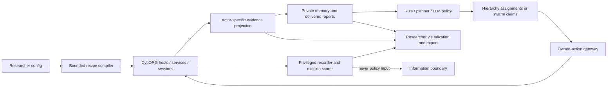
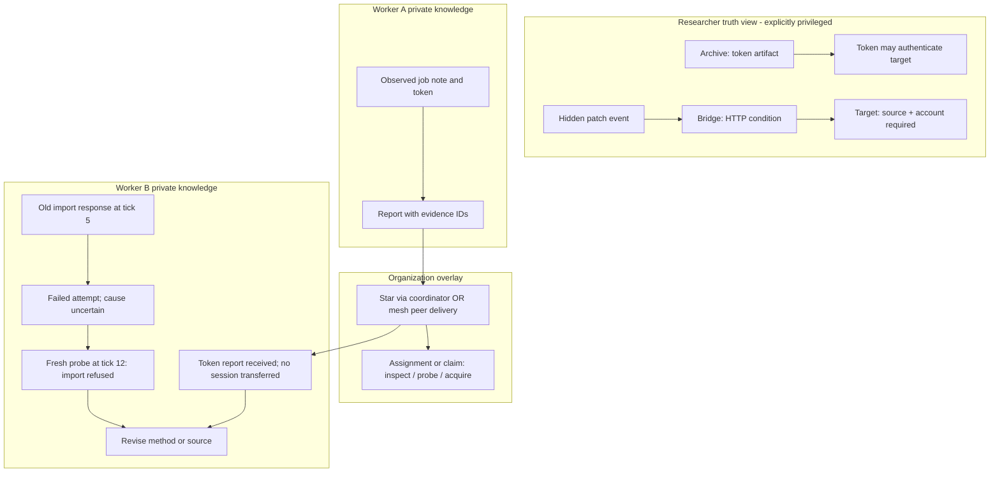

# Revised graduation research and implementation plan

5 October 2026. **Plan and source audit only. No implementation, new simulation
runs, research experiments or live LLM calls were performed for this revision.**

This is the authoritative remaining project scope. It supersedes conflicting
future requirements in IMPLEMENTATION_PLAN, SYSTEM_DESIGN, RESEARCH_PROTOCOL and
ENVIRONMENT_COMPLEXITY_DESIGN. Historical acceptance records remain evidence of
their stated software scope; they are not retrospectively promoted to research
validation. [Source audit and literature](PLAN_SOURCE_AUDIT.md) records the basis
and limits of this revision. The original report and poster have not been edited.

## 1. The project in one page

**Question:** How do hierarchical and swarm LLM attacker teams investigate,
coordinate and adapt in a small, partially observed cybersecurity simulation?

Keep CybORG CC4, the existing local service, private agent memories, message
transport and browser workbench. Add one bounded research profile, not a full
cyber range or a general simulator framework. Its required behavior consists of:

1. **Investigating access conditions.** A service scan does not tell an agent
   which approach works. Two explicit simulated techniques and credential login
   have different conditions. Legal probes and local artifacts provide evidence.
2. **Combining capabilities from different places.** One branch can provide a
   useful source host; another can provide a credential or an address. Possessing
   one does not automatically provide the other. Teams can divide and combine work.
3. **Rechecking after a defensive change.** One bounded patch or restoration can
   invalidate a previously justified plan. Evidence has timestamps and stays old
   until the agent investigates or receives a delivered report.

Use three small mission families: investigation, complementary branches, and
recovery. Retain a simple linear control. Start with two workers; qualify four
as the only required size sensitivity. Both organizations receive identical
technical worlds and starting access. A hierarchy adds a sessionless coordinator;
a swarm uses delivered peer claims. Count all coordinator resources.

The intended system makes a **single unchanged attack sequence** inadequate
across selected supported cases. It does not make competent programmed
investigation impossible. A strong evidence-aware planner may succeed; whether
LLMs help, and which organization helps, are empirical questions.

**Next engineering milestone:** qualify one pair of indistinguishable initial
worlds in which an explicit access attempt fails, an investigation distinguishes
the conditions, and the justified next action differs. Do this before another
large seed sweep or live LLM qualification. This revision authorizes none of those
activities; it defines their future completion criteria.

## 2. Research questions, hypotheses and permissible claims

Primary RQ: Under matched workers, action opportunities and total model resources,
how do hierarchy and swarm differ in mission success, investigation effort,
coordination cost and recovery in these abstract missions?

Supporting RQs: Does exchanging complementary evidence help compared with
independent workers? Does defensive change expose differences in evidence refresh
and reassignment? Do observed differences survive held-out arrangements and a
strong non-LLM controller?

| Hypothesis to test | Observable prediction | What can refute it |
| --- | --- | --- |
| H1: Central allocation helps coupled tasks | Hierarchy duplicates fewer probes/acquisitions when evidence from separate branches must be combined | Similar or worse success/effort after coordinator costs |
| H2: Local autonomy helps after changes | Swarm resumes justified progress sooner when local discoveries invalidate a shared plan | Hierarchy adapts equally well or better; swarm spreads stale evidence |
| H3: LLM policies generalize better than a fixed workflow | Fewer inappropriate repeated attempts on held-out combinations | An evidence-aware programmed policy matches/beats LLMs |

H1/H2 retain the report's efficiency/adaptation motivation but are conditional,
not universal properties of hierarchy/swarm. H3 is a diagnostic hypothesis; the
main contribution remains organization, not proving that only LLMs can reason.

Claims may concern autonomous teams **in the documented abstract model** and
specific causal mechanisms supported by ablations. Do not claim human fidelity,
real exploit competence, incident-rate calibration, general superiority to
rules/RL, or top-conference novelty from software checks. Documented cyber
behavior motivates mechanisms; it does not validate our numerical parameters.
Results, external validity and a publication contribution remain unproven.

The report/poster need later editorial correction: ABM is not synonymous with
rigid scripts; CALDERA supports fact-driven adaptive planners; offensive LLM
teams and cyber organization studies already exist. Fifty trials do not by
themselves guarantee significance, and lower behavioral variance is not always
better. [Primary evidence](PLAN_SOURCE_AUDIT.md) supports these corrections.

## 3. Current system: verified scope and specific gaps

This is a source-and-record audit, not a new runtime qualification. The last
recorded suite has 149 Python tests, eleven frontend checks and a production
build. No tests were rerun for this plan revision.

| Area | Implemented and boundedly checked | Missing for this study |
| --- | --- | --- |
| Technical engine | Isolated CC4 adapter, owned native sessions/caches, native busy actions, source blocks and privileged pivot extension | Research-specific diagnostics, artifact/credential possession and explicit access methods |
| Generated worlds | Controlled population/services, seeded gateway placements, 1–3 layers, alternatives and hardened dead ends | Distinct capability/dependency recipes; existing branches mostly share downstream inventory |
| Choices | High-level generic exploit, escalation/inspection, source selection; duration/exposure/privilege tradeoffs | Agent chooses a concrete method; compatibility must not be selected internally for it |
| Knowledge | Private observations, verified delivered address/clue evidence, age/history/conflicts and delayed projection | Typed diagnostic/artifact evidence and credential reports; no current credential sharing contract |
| Changes | Native observation-driven Restore; separate traffic-driven temporary service quarantine | A qualified patch transition and diagnosis of changed compatibility |
| Missions | Multiple targets, real privileged access, live prerequisites, dwell and deadlines | Capability dependencies tied to alternative approaches and meaningful parallel investigations |
| Organizations | Delivered hierarchy assignments, swarm claims, independent control, configurable transport | Task identity and claims must cover methods/probes/artifacts, not just host/action |
| Cognition | Fixed priorities, heuristic replanning and observed-graph search; Ollama adapter/accounting | Baselines using the new methods; live provider qualification remains absent |
| UI/evaluation | Paused initialize, private/truth graphs, replay, evidence export, basic metrics and matrix preview | Investigation/credential panels, decision-demand reducers, bounded batch execution and final analysis |

### Why a repeated workflow currently succeeds too easily

* `cc4/routes.py:23` assigns gateways the same previous sources and next-layer
  leads. Varying placement/width changes traversal work more than strategy.
  **Change:** compile small recipes where source access and credential possession
  are distinct requirements, with different downstream permissions.
* `routes.py:87` writes next-hop addresses into every gateway's inventory.
  **Change:** use limited artifact-derived leads; keep addresses as clues, not a
  complete route/dependency disclosure. A route to an address is not sufficient
  authentication or privilege.
* `policies.py:89` offers generic ExploitRemoteService; native code chooses its
  sub-action. FTP's compatibility test is unconditional once other native
  prerequisites hold. **Change:** explicit supported methods with documented
  predicates, positive/negative fixtures and observable diagnostic behavior.
* The 27-tick fixture has one target, passive native Blue, immediate evidence,
  one short sensor block and a deadline of 150. Existing access survives that
  block. **Change:** persistent incompatible conditions plus recoverable
  alternatives, and one qualified knowledge-invalidating intervention.
* Candidate generation and `local_search` already encode the technical sequence
  and optimistic continuation costs. **Change:** document those priors, retain
  strong controls, and expose the same causal catalog/evidence to every policy.

The same `local_search` completed bounded C0, two-target/dead-end C1, native
restoration C2 and route-pressure fixtures, including organization checks.
Four wider generated cells used a **truth-guided legal witness**, not that
autonomous policy. They establish legal trajectories only. See
[the detailed audit](REASONING_DEMAND_AUDIT.md) and
[historical acceptance](OBSERVED_SEARCH_ACCEPTANCE.md).

## 4. Scope: three mechanisms, a small catalog, no broad framework

Required research catalog: two simulated exploitation methods (`web_rfi`,
`ssh_weak_auth`) plus explicit `credential_login`. RFI here is an abstract
remote-file-inclusion condition, not payload generation. The SSH method abstracts
weak authentication; login is a different operation with an acquired credential.
Reuse native HTTPRFI/SSHBruteForce effects where qualified. Login is a **new
simulated action**, not an existing verified CybORG credential feature.

Required new action families: `Probe`, `InspectArtifacts`, `AttemptAccess`.
Reuse discovery, service scanning, escalation/inspection, pivot deployment and
Sleep. Reuse reporting/assignment/claim transport. Keep escalation high-level;
explicit escalation technique selection is unnecessary for this question.

The first recipe uses 6–8 designated hosts across four logical research zones.
**Stock CC4 still materializes its larger fixed enterprise layout.** Bind these
roles to selected native hosts; background hosts stay visible in researcher truth
but have no research artifacts or alternative attack route. Enforce denial of
unsupported background shortcuts. Do not claim CC4 now generates an arbitrary
four-zone/eight-host world. A graph toggle can show the relevant subgraph.

Core changes are **patch OR Restore**, at most one defensive response in a core
episode. Patch stays effective for the episode; retries cannot undo it. Restore
removes actual owned sessions. Keep existing service quarantine available for
historical/control profiles; composing patch, Restore, isolation and rotation is
not a graduation requirement.

### Optional, explicitly deferred

Full host isolate/unisolate; credential rotation and account lockout; many exploit
families; SQL/SMB/AD/Kerberos/MFA; realistic credential cracking; decoys and benign
traffic; generic arbitrary graphs; learned/adaptive defenders; joint optimal
POMDP planning; adaptive organization; broad model/size sweeps; packet/protocol
emulation; cyber-range transfer; production systems. None is silently considered
implemented or scientifically unnecessary. Each broadens claims and engineering
scope beyond the selected research question.

## 5. Mechanism M1: evidence-dependent approaches

**Real-world basis.** Service discovery supports selecting possible remote
exploitation; valid accounts and credentials found in files provide different
access routes. ATT&CK documents these separately. Microsoft's Volt Typhoon
investigation describes credential collection, network discovery and subsequent
authentication. These motivate the distinction; our conditions/costs are design
assumptions. [T1046](https://attack.mitre.org/techniques/T1046/),
[T1210](https://attack.mitre.org/techniques/T1210/),
[T1078](https://attack.mitre.org/techniques/T1078/),
[T1552.001](https://attack.mitre.org/techniques/T1552/001/),
[Microsoft investigation](https://www.microsoft.com/en-us/security/blog/2023/05/24/volt-typhoon-targets-us-critical-infrastructure-with-living-off-the-land-techniques/).

**Abstraction boundary.** Represent service features, authentication policy and
small readable configuration/log artifacts. Omit packets, real passwords,
payloads, CVE matching and a complete OS. Preserve deciding what to investigate,
which method fits evidence, and whether authentication material applies.

**Hidden state.** HTTP import feature enabled/disabled; SSH weak account
present/hardened; credential-to-account/service scope and current validity; source
ACL permission. A banner alone does not reveal all conditions. Static hardened
variants are not defeated by more retries. Credentials are opaque simulation
tokens with a claimed scope in an artifact, not real secrets.

**Evidence.** Scan returns ports/service families. `Probe(service_behavior)`
returns a feature response such as external-import refused; `Probe(auth_policy)`
returns supported authentication modes, not password strength or credential
validity. `Probe(connectivity)` returns handshake/timeout from the selected
source. `InspectArtifacts` reads only accessible local files/notes, such as an
account-provisioning note, a destination used by a job, or a stored token. Strong
versus weak passwords are not magically inferable from a network banner. Recipes
using that distinction must supply a legitimate local provisioning clue or allow
uncertainty to remain until a bounded attempt.

**Choices.** Try the observed service's technique; obtain/use a scoped credential;
probe first; inspect another host; select another source. Both valid and invalid
methods remain selectable when visible prerequisites permit them. Candidate lists
never contain only methods guaranteed to succeed.

**Adaptation.** A later patch can disable import without closing HTTP. A failed
attempt does not announce “patched.” A fresh behavioral probe can contradict the
older response. Credential revocation is optional; core artifacts may already
contain an invalid or wrong-scope token with a discoverable alternative.

**Implementation.** Engine-local service-condition records, credential records,
artifact access predicates and a three-method registry. Put failure causes in
privileged logs only; put observable responses in actor projections. Use native
HTTPRFI's `rfi` process-property predicate and native SSH user flags consistently.
The credential action needs a reviewed native session factory after successful
reachability/authentication checks; never grant sessions in the service or UI.

**Qualification.** Paired initial observations/candidates, contrasting feature
responses, wrong-scope login rejection, source-specific connectivity, no access
from fabricated token IDs, and persistent failure of incompatible retries. A
deterministic condition-aware policy must be able to use this evidence too.

## 6. Mechanism M2: complementary capability routes and distributed knowledge

**Real-world basis.** Lateral movement can involve exploring/pivoting through
systems and accounts, using exploitation or valid credentials. ATT&CK distinguishes
access techniques rather than treating every reachable machine as equivalent.
[Lateral movement](https://attack.mitre.org/tactics/TA0008/).

**Abstraction boundary.** Keep source-specific reachability, account scope,
privilege and credential possession. Omit full trust domains, routing protocols,
ACL syntax and credential cryptography. These primitives suffice to model a
technical dependency that communication alone cannot satisfy.

**Hidden state.** Which bridge can reach which service; where a relevant token
or address is stored; which account authorizes the target; which route remains
compatible. Role placement and dependency arrangement vary independently of
architecture. A credential-source host need not also provide target reachability.

**Evidence.** Owned-host artifacts contain limited neighbor/job connection leads,
account names and tokens. Agents discover address/source relationships through
legal probes. Two workers can acquire different evidence and access because they
explore different branches. No complete capability graph is supplied.

**Choices.** Investigate the credential branch, acquire a usable bridge, forward a
token report, request a specific probe, or acquire an alternative bridge. Two
targets give useful parallel work; a target needing both a bridge and a token
creates a merge dependency rather than a common repeated chain.

**Adaptation.** Losing the bridge invalidates the source route even if a stored
credential remains useful. New access must be acquired legally. A delivered old
report does not recreate a session or a native scan cache.

**Implementation.** Three dependency primitives only: reachable-from-owned-source,
credential-valid-for-target-account, and owned-local-privilege. Actor-local token
possession is updated through inspection or verified delivery. Extend transport
evidence allowlists to diagnostics/artifacts/tokens, preserving origin and observed
tick. A relay checks the actual sender's authorized evidence chain. The
coordinator can forward reported token references but never acquire native access.
References do not contain a hidden validity flag or exhaustive true scope.

Default two-worker missions start on the same entry host; a **required matched
distributed-access fixture** places them on two declared entry hosts. Qualify four
workers by distributing two per entry in that fixture. This promotes one previously
optional access-placement sensitivity to core organizational qualification.
Placement/resources are identical between hierarchy and swarm, and worker IDs are
permuted independently of role placement. Do not hardwire “Worker 0 is scanner.”

**Qualification.** A bridge without a token cannot authenticate; a token without
a reachable source cannot reach the target. Sharing a token enables login only
after the recipient independently meets source/scan requirements. No session,
privilege or cache transfer. Two legal discoveries must be mergeable through both
star and mesh transport; undelivered knowledge must remain unavailable. Measure
useful parallel work, not worker count alone.

## 7. Mechanism M3: changed conditions and stale reports

**Real-world basis.** Updating software changes attack surfaces; defensive
containment/recovery changes access. D3FEND distinguishes software update from
network isolation and credential eviction. CybORG supports native restoration;
patching is an extension in related CybORG work, not proof of this adapter's patch
support. [Software update](https://d3fend.mitre.org/technique/d3f:SoftwareUpdate/),
[Network isolation](https://d3fend.mitre.org/technique/d3f:NetworkIsolation/),
[CybORG extension study](https://arxiv.org/abs/2508.19278).

**Abstraction boundary.** One persistent feature-disabling patch OR one native
Restore. Preserve a formerly reasonable approach becoming ineffective and the
need to refresh/reallocate. Omit patch deployment infrastructure, service downtime
and unrestricted adversarial play. No abstract parameter is called an empirical
response rate.

**Hidden state.** Pending response, exact effect time and affected condition.
Defenders know their own managed service inventory and delivered sensor evidence;
they do not query true red compromise or select a victim by organization label.

**Evidence.** Native Monitor/qualified traffic telemetry can trigger defense.
Attackers receive only action symptoms, immediate own-session status, or fresh
probe results. Peers learn through actual messages. A stale label is computed
from age, not a secret global condition-revision comparison.

**Choices.** Verify old information, investigate another service/source, keep a
still-valid credential, reacquire a bridge, or revise task ownership. Scenarios
must preserve a supported recovery alternative; simply waiting out a block is not
the only solution in the required change family.

**Implementation.** Versioned `PatchService` transition removes the native RFI
property; HTTP remains listening, existing sessions remain active. Native Restore
removes sessions with its existing checked semantics. Restore and patch on the
same host are excluded from core combinations until persistence/reset interaction
is separately qualified. No patch “auto-unpatch” timer. Native port caches can
stay unchanged because the port remains open; observations are not secretly
cleared/updated to disclose the patch. Fresh probes append contrary evidence.

Use a single core response budget across managed hosts, not silently one budget
per Blue actor. Current RestorePolicy has per-Blue budgets: its integration needs
a small explicit shared budget ledger for this new profile. Passive/scheduled
and observation-reactive modes are labeled separately. Scheduled change isolates
adaptation; reactive change checks behavioral consequences. The required suite
qualifies one intervention, not continuous unlimited defense.

**Qualification.** Before/after probes differ; repeated patched exploits stay
unsuccessful; current owned sessions survive patch but disappear under Restore;
stale peer evidence stays stale; another legal approach succeeds in a recovery
witness. Log alert, decision, effect and first attacker-visible symptom separately.

## 8. Concrete missions and decision loops

These are **proposed examples, not executed runs**. Investigations may be coded
by non-LLM policies. Any hypothesis text is an agent's proposed interpretation,
not ground truth supplied by the engine.

### Mission A: determine why access is failing

Public brief: acquire privileged access to the archive target. Initial entry,
discovered addresses and HTTP/SSH banners match across paired variants.

1. Observe: an explicit `web_rfi` attempt failed without a cause label.
2. Hypothesize: source connectivity changed, or the import feature is unavailable.
3. Investigate: source-specific connectivity probe; if connected, inspect the
   HTTP behavioral response. A timeout is not called “defender blocked me.”
4. Choose: use another bridge if that source cannot connect; obtain a credential
   for SSH if HTTP is reachable but import is refused.
5. Act: login with a legitimately acquired scoped token, then acquire necessary
   privilege and access.
6. Reassess: check own result/session status rather than treating the plan as success.

A separate paired login failure distinguishes rejected authentication from
inaccessible service. Do **not** make one exploit action fail because of a
credential it never used. Similar outward failures belong to well-defined actions.

| Hidden variant | Useful observable result | Justified response |
| --- | --- | --- |
| Import disabled, connectivity allowed | HTTP handshake; behavioral probe refuses import | Investigate credential path or another compatible service |
| Import enabled, source denied | Timeout from this source; successful probe from another acquired source | Change source/bridge, then investigate/attempt |
| Wrong-scope credential, SSH reachable | SSH handshake; login rejects token; another local artifact identifies a relevant account | Acquire a correctly scoped token |

Identical retries cannot change an unchanging feature, token or ACL. Finite task
costs make investigation economical, but the **different causal prerequisites**,
not the deadline alone, create the decision challenge.

### Mission B: combine two branches for two targets

The archive branch contains a scoped token and a limited target-address lead.
The web branch provides a bridge with service reachability but no credential.
Target A requires the bridge plus that token. Target B is accessible through a
different supported technique on the other branch. Selected variants exchange
token placement, bridge permissions and compatibility while preserving a solution.

Worker A investigates artifacts; Worker B probes/acquires the bridge. A hierarchy
must relay reports, merge prerequisites and assign executable work to the right
owner. A swarm must exchange evidence, reconcile claims and avoid duplicate
acquisitions. Neither can give B ownership of A's session through a report. Without
sharing, a worker may repeat both investigations and acquire both capabilities;
sharing offers a measurable opportunity, not an architecture-specific win rule.

### Mission C: replan after an old conclusion becomes false

A successful probe suggested import was enabled. That evidence is reported while
the defender later patches the bridge. A worker's old `web_rfi` attempt now fails.
The worker checks connectivity, gets a new refusal response and reports evidence
with a later observation time. The team abandons that method, obtains a token or
another bridge, and completes both targets for a short declared hold. In the
Restore variant, source access disappears and must be reacquired. Short holds
exercise persistent coordination, not a full stealth/persistence campaign.

## 9. Configuration and supported controls

No global difficulty number. Controls describe changed mechanisms; values are
development starting points, not calibrated difficulty or real incident rates.

| Control | Initial supported choices | What changes; important limits |
| --- | --- | --- |
| Recipe | linear_control / investigate / combine / recover | Bounded dependency/evidence arrangement; no unrestricted graph editing |
| Conditions | single / paired | One uncertain service condition or a paired service/credential dependency; at most two candidate tokens per required account |
| Capability coupling | separate / bridge_and_token | Whether one target needs evidence/access from two branches |
| Evidence | immediate or delay 0–2 ticks; age threshold 4–12 | Delivery/age only; age does not mean actual falsity |
| Change | none / scheduled_patch / reactive_patch / reactive_restore | At most one effect; patch and Restore are alternative core treatments |
| Reactive settings | delay 2–8 ticks; budget 1; fixed named sensor coverage | Exact pending/effect times stay hidden; ranges require qualification |
| Task resources | horizon, short hold 1–3, total attempted-access budget | Team-wide attempts charge admitted completed access attempts, including failures; probes cost ticks; no hidden score penalty |
| Organization | hierarchy / swarm / independent; workers 2 or 4, single control 1 | Same executor resources within each comparison; count coordinator tokens |
| Starting access | common_entry / matched_split_entry | Same placements across organizations; split fixture cannot grant special abilities to one organization |
| Transport | healthy or one impairment: extra delay 2 | Reuse current message overlay; delay is not packet-network congestion |
| Seeds | network, recipe, event/sensor, transport, schedule namespaces | Vary placement, hidden conditions, artifact placement and dependencies; not just IP addresses |

Retain existing broader knobs on historical profiles. The new profile's qualified
core rejects unsupported combinations rather than exposing every old control.
Examples: patch requires web_rfi in the catalog and a relevant probe; a
credential-only target requires a reachable credential source; split entry
requires at least two workers; response budget cannot target entry footholds;
the recover recipe must retain an alternative; current stock mission-phase
firewall changes are disabled or held fixed under a named new-profile policy
so they do not introduce unmodeled causes. Verify that policy in the native action
path, not just a UI diagram.

**Feasibility:** compiler checks dependency reachability, credential scopes,
artifact readability and available methods. A bounded privileged reference search
then generates a legal action witness including discoveries/probes. Save it to
researcher-only qualification artifacts; it is never a competing policy. Check
both selected intervention variants and conservative action/transport budgets.
`verified`, `infeasible` and `unverified` are separate results. A positive static
witness is not a guarantee against every reactive trajectory. Use a documented
small reactive state/action search for these finite recipes or mark that specific
composition unverified. Final inclusion decisions precede treatment outcomes;
never drop a world because a favored agent loses.

Design-only configuration examples:
[investigation](examples/minimal-investigation.plan.json) and
[distributed recovery](examples/minimal-recovery.plan.json). They deliberately
do not conform to current runtime schema-1.0 and must not be run/imported as
working episode configs. Milestone R1 introduces the explicit new contract.

## 10. Architecture and programmer interfaces

Keep this repository and branch. Retain vendor checkouts and existing code. Add
a bounded `enterprise_cc4_research` profile; do not alter old profile semantics.
Introduce an explicit next episode contract version, with a small research
module version, rather than rewriting all configuration into a plugin framework.
Old configs/replays stay version-1 objects. No automatic reinterpretation.

```text
packages/contracts/research_profile.py       proposed strict bounded config/action/evidence models
packages/engine_worker/cc4/research/
  compiler.py                              recipes, role binding, feasibility witnesses
  state.py                                 conditions, artifacts, credentials, actor possession
  actions.py                               Probe, InspectArtifacts, AttemptAccess + native hooks
  evidence.py                              filtered observations and verified forwarding
  changes.py                               PatchService, shared response budget, event rules
backend/app/knowledge.py                    extend existing ledger, do not create shared memory
backend/app/policies.py                     method-aware candidates/tasks/claims
backend/app/baselines.py                    new versioned evidence-aware controller
backend/app/evaluation.py                   versioned event reducers and batch comparison
frontend/src/InvestigationEvidence.tsx      proposed panel; reuse graph/timeline/control components
scenarios/research/{recipes,splits}/        bounded recipes and immutable split manifests
tests/research/                            proposed acceptance fixtures and privacy cases
docs/research/                             this plan, evidence register, acceptance records
```

These are proposed paths; no modules/directories above were created by this audit.
There is no new microservice, database, language, engine runtime or cloud resource.
Only the engine worker imports CybORG or reads hidden conditions. The backend
handles cognition/organization/transport; it cannot determine physical success.



### Required contract semantics

`compile(recipe, seed_namespaces, actor_resources) -> MaterializedWorld` contains
native bindings, conditions, dependencies, artifact locations, defender policy,
allowed methods and qualification status. It does not read architecture/model.
It has a canonical world hash. Public catalog and actor initial views are separate
objects. Compiler/reference truth must never be merged into AgentView.

`ActionRequest`: actor, action, own source session, observed target, service/port,
probe kind OR access method, optional possessed credential reference and local
artifact selector. Strict union fields prevent a web exploit silently consuming
a credential or switching techniques. Same gateway validates every policy's
request, not only the default candidates. Hidden incompatibility produces an
executed failure, never a helpful preflight “patched” rejection.

`EvidenceRecord`: id, observing actor, observation tick, source host/session,
action id, fact type/value, visibility, provenance chain, and received tick when
reported. Store structured facts plus a deterministic plain-language rendering
for all policies. Never attach hidden cause, true credential scope/validity,
future defense event, hidden revision or expected successful route.

`PublicActionCatalog`: methods, general causal prerequisites, declared costs and
possible observable responses. Its descriptions are identical for all policies.
Mechanical prerequisites are public knowledge; current hidden predicates are not.
Candidate generation uses only visible facts and ownership, not truth. Task/claim
keys include source, service, method/probe kind, token/artifact reference and
relevant evidence IDs. Otherwise different investigations could be accidentally
deduplicated or wrong assignments rebound to a different method.

`TransitionEvent`: privileged cause and before/after effect, public evidence
projections if any, phase, signal/decision/effect times and response budget.
Researcher diagnostics can join cause to symptom; policy inputs cannot.

### Action/state semantics to implement

| Action | Public mechanical prerequisites | Effect/observable result | Initial cost assumption |
| --- | --- | --- | --- |
| Probe(connectivity) | Owned active source, known destination/service | Handshake or timeout from that source; no global ACL map | 1 tick |
| Probe(service_behavior/auth_policy) | Same plus observed service family | Feature response / supported auth modes; no guaranteed-vulnerable flag | 2 ticks |
| InspectArtifacts | Active owned local access with declared read privilege | Small note/log/token record or readable absence/denial | 2 ticks |
| AttemptAccess(web_rfi) | Own source scan, known HTTP family | Native-backed owned session iff reachability and RFI property allow | 4 ticks |
| AttemptAccess(ssh_weak_auth) | Own source scan, known SSH family | Native-backed owned session iff reachability and weak-account condition allow | 4 ticks |
| AttemptAccess(credential_login) | Own source scan, observed SSH family, legitimately possessed token | Owned session iff reachable and token matches allowed account; no auto-escalation | 2 ticks |
| Existing escalate/inspect and pivot | Current actor-owned target access/privilege requirements | Existing qualified native effects; root not guaranteed by a task label | Existing pinned duration |

Durations above are proposed initial modeling parameters. All costs appear in the
common catalog; validate actual native busy/continuation semantics. Login account
privilege is a declared template property, not “all tokens grant root.” Neither
Probe nor InspectArtifacts acquires a session. Technical prerequisites are checked
again at completion so an intervening patch can make an in-flight attempt fail.
Busy work cannot be cancelled in the core profile; other workers can continue.

Reserve one team access-attempt slot at admission and settle it on completion;
concurrent workers must not overspend the remaining allowance. Interrupted
in-flight work is retained as a reserved/partial attempt, not silently refunded
into another episode. Do not count one continuation tick as a new attempt.
Publish account/technique rules and artifact formats in a short common manual;
use neutral host identifiers so role or vulnerability names do not leak the recipe.

At boundary t: deliver messages/due evidence, update private memory, collect
proposals, admit actions; apply due pre-native transitions for t+1; execute one
native joint tick with pinned priorities; collect actual action/Monitor results;
queue future defender responses; project evidence; score end-of-tick native
sessions; persist. Native Restore obeys recorded native completion ordering;
custom patch applies at the declared pre-native phase. Never advance a tick per
worker or because an LLM response takes longer. Observe/act races must have
same-tick fixtures and recorded execution order.

Example actor-visible evidence after investigation:

```json
{
  "actor": "Red_1", "tick": 12,
  "evidence": [{
    "id": "ev-12-Red_1-2", "observed_tick": 12,
    "source_host": "bridge-03", "target": "10.4.0.12",
    "action": "Probe", "kind": "service_behavior",
    "facts": {"service": "HTTP", "external_import_response": "refused"}
  }],
  "hypotheses": [{
    "author": "Red_1", "claim": "The old import observation may no longer apply",
    "support": ["ev-12-Red_1-2"], "status": "agent_inference"
  }]
}
```

Hypotheses are optional concise decision annotations written by the policy. Their
presence or eloquence is not scored as correct reasoning. Actions and evidence
use are the behavioral evidence. An LLM is never required to expose a private
chain of thought; a short cited decision summary is enough.

## 11. Visualization and researcher workflow

Required UI views use the existing local browser workbench. The diagram below is
a **design illustration**, not a captured implementation/result.



Keep network, organization and knowledge as separate layers, not one graph that
silently shows every worker every host. The relevant-network graph shows
discovered hosts and observed connections in a worker view; it uses dashed
relationships for hypotheses/reports, with evidence references. Researcher truth
may display actual scopes, blocked edges, patch events and dependencies. Its
banner remains visible; switching view cannot affect policy context.

| Panel | What the researcher can inspect |
| --- | --- |
| Network | Known service, owned access, source used, observed/unknown connectivity; truth overlay separately |
| Investigation | Attempt → hypotheses proposed → probe → observed response → chosen method; no invented reasoning narrative |
| Knowledge | Who observed/reported each fact, observation/receipt time, age, conflicts and refresh |
| Coordination | Delivered assignments/claims, token/evidence relays, waiting, revisions and duplicate work |
| Environment timeline | Signals, response decisions/effects and attacker-visible symptoms on separate tracks |
| Mission/resources | Actual target access/hold in truth; public brief and own access in worker view; attempts/ticks/tokens/bytes |
| Results | Paired outcomes, investigation/recovery costs, failure categories, world/split/policy versions |

Researcher flow: select a recipe → set condition/change/transport controls →
review resolved values and feasibility → initialize paused → step/run → inspect
private discoveries and decisions → replay/export. For evaluation: choose the
frozen split and comparisons → preview job/resource counts → execute an authorized
bounded batch → recompute metrics offline. UI and headless execution consume the
same config and core loop. No experiments are encoded in UI click sequences.

Forms/JSON control qualified recipe, seed, module values, team, transport, model,
budgets and batch selection. Programming is needed for a new technique, artifact
rule, defender effect, dependency primitive, organization policy or metric.
Unsupported controls remain disabled. Editing settings creates a new run;
exploration interventions keep the existing evaluation-ineligible flag.

## 12. Acceptance: prove decision structure before studying performance

The following are future software qualification fixtures. No scientific outcome
or LLM advantage follows from passing them. Tests use native owned actions and
legal evidence, not session injection.

| Gate | Measurable acceptance |
| --- | --- |
| A1: Same initial evidence | Paired hidden-condition cases have byte-identical actor/coordinator inputs and candidate identities before a distinguishing probe, after normalizing run IDs |
| A2: Useful investigation | Legal probes give different observed results; declared method/source predicates justify different subsequent decisions; neither clue is a complete plan |
| A3: Incompatible retries | At least three unchanged attempts fail in each persistent negative condition; no retry-triggered unpatch/token repair/ACL override |
| A4: Value of information | On small paired fixtures under identical attempts/ticks, compare a fixed method sequence, blind retry and a scripted evidence-conditioned witness; hand-check the latter's lower wasted attempts or better completion, not only a harsher deadline |
| A5: Dependency merge | Token alone and bridge alone fail; combined legitimately acquired capabilities succeed; inaccessible background routes cannot bypass the dependency |
| A6: Changed conclusion | A prior positive probe becomes contradicted after patch; old inputs stay unchanged until a permitted signal; a recovery trajectory uses the changed evidence |
| A7: Real access loss | Native Restore removes owned sessions/caches; scorer/holds react; legal reacquisition creates no transferred cache |
| A8: Team information boundary | Both hierarchy and swarm merge complementary delivered evidence; no undelivered report/forged token gives capabilities; coordinator never reads undisclosed peer memory |
| A9: Clock/lifecycle | Native busy work, budget, patch completion races, response phases, fresh reset, no-op parity, replay and artifacts agree |
| A10: Supported generation | Every core recipe/worker/condition/change combination has positive/negative fixtures and a feasibility report; unverified combinations are rejected or explicitly excluded before studies |

A4 establishes useful evidence in those **specific fixtures**, not inability of
all fixed/non-LLM programs to solve the family. Public rules can be encoded in a
condition-aware decision tree. Do not use a deliberately oblivious controller as
the only baseline. A full repeated workflow may still solve the linear control.
If investigation does not change behavior/cost in paired fixtures, revise the
mechanism before widening generation. If organization has no useful parallel or
merge opportunities, revise that mission before model studies.

Behavioral evidence levels: specified → software-qualified → supervisor/expert
reviewed. Obtain review of at least one worked trajectory per mechanism and record
disagreements/assumptions. Optional lab comparison is needed for stronger transfer
claims, not to finish this simulation graduation project. Describe entities,
states, private observations, submodels and scheduling in an ODD-style appendix.
[ODD guidance](https://www.jasss.org/23/2/7.html).

## 13. Baselines and fairness

Preserve existing `local_rules`, `local_replan`, `local_search` versions and their
historical profile results. Do not run those old action catalogs on a new profile
and call incompatibility a reasoning failure. Add qualified versioned mappings
or new baseline IDs for the new action catalog.

Required controls: (1) repeated workflow with bounded retries, transparently
labeled fixed priorities; (2) competent evidence-conditioned programmed
controller that diagnoses/refreshes and chooses explicit methods; (3) current
observed-search approach extended to new prerequisites, labeled planning and
qualified without global-optimality claims; (4) a single LLM and independent LLM
workers for selected diagnostic comparisons. Use the same organization code for
scripted-team comparisons where relevant. No full optimal POMDP solver required.

Document built-in knowledge: public technique predicates and costs, supported
artifact meanings, source/session requirements, age/refresh rules, routing
heuristics and failure backoff. This is simulator-specific knowledge. Give LLMs
the same public manual/cost catalog and structured facts, not hidden manifests.
Neither candidate filtering nor a common state tracker may supply a strategy to
one policy only. Search estimates use visible facts/public priors and explicitly
mark unknown conditions. “Knows the rules” differs from “knows this world.”

Freeze policies, prompts, examples, catalog and parameters before held-out runs.
Do not edit the baseline after inspecting final failures. A competent non-LLM win
is an accepted outcome. Uncertainty-aware planning has prior research support;
uncertainty is not an LLM monopoly. [POMDP attack planning](https://arxiv.org/abs/1307.8182),
[CALDERA planners](https://caldera.readthedocs.io/en/5.0.0/How-to-Build-Planners.html).

Within hierarchy/swarm pairs: same native worker count/placements, model settings,
public catalog, memory format, total attempted-access/action and token ceilings,
transport byte/envelope capacity, mission and defender policy. Hierarchy's
sessionless leader costs count. Graph topology and assignment/claim behavior are
the organizational treatment. It is a comparison of these concrete implementations,
not all possible hierarchies/swarms. Message recipient copies count toward cost.
Busy workers make no extra cognition calls. Match the scheduler; report simulation
ticks separately from wall-clock/provider latency. Include a small team-action-cap
sensitivity so extra parallel executors are not mistaken for smarter reasoning.

## 14. Evaluation, held-out worlds and reproducibility

Primary endpoint: mission success under the declared tick/attempt/token limits,
scored from actual active qualifying target sessions and dwell. Record failure
by horizon/budget, refusals/invalid decisions, technical errors and intervention
separately. Never retry ordinary failure until it becomes a success.

| Secondary metric | Definition / safeguard |
| --- | --- |
| Completion effort | Joint ticks and admitted attempted access; report with success, plus predeclared failure-aware restricted completion time |
| Investigation effort | Completed probes/inspections; compare useful evidence acquisition and subsequent action differences, not “more probes = smarter” |
| Wasted attempts | Access attempts repeated with same source/method/token and no new relevant evidence or justified expected state change; event-based conservative definition |
| Coordination | Recipient-copy bytes, assignments/claims, redundant comparable investigations, waits and evidence relays |
| Recovery | First observable disruption → first valid renewed progress / restored target access; no-observation and no-recovery cases censored/separate |
| Information | Evidence age at use, conflicts, refresh and use of delayed reports; do not assume age means wrong |
| Model cost | All worker/leader/repair/summarization input/output tokens and actual usage status; success-versus-cost frontier, not just tokens per successful run |
| Mechanism behavior | Method/source change after distinguishing evidence, dependency-completing reports and reassignment after loss; rationale text alone is insufficient |

A common metric reducer uses recorded actions/evidence/delivery/native effects.
Researchers may inspect hidden causes offline for failure analysis; competitors
never receive that analysis. Hand-count one fixture per metric and version formulas.

Keep the study small: four families (linear control plus A/B/C), two/four workers,
one model for the main graduation comparison, and one transport impairment on a
selected coordination family. Do not launch a full Cartesian product of every
knob. Primary contrasts are hierarchy minus swarm on B/C; control A/linear and
selected non-LLM/single/independent comparisons diagnose the mechanism. A second
model and additional impairment are extensions for broader publication robustness,
not prerequisites to start this bounded project.

Development worlds tune mechanics/baselines and estimate cost/variance. Validation
worlds qualify the frozen proposed family. Test worlds use withheld **combinations
and placements** of already documented causal rules: artifact locations, bridge
permissions, conditions, target assignment and change location/latency. Renaming
IPs alone is not a holdout. Never introduce an undocumented new technique solely
in test. Hold out at least one meaningful dependency/condition combination, not
only seeds, and verify split uniqueness by canonical recipe/materialized hashes.

Pre-register primary endpoint, contrasts, exclusions, stop/retry rules and sample
size rationale after an explicitly authorized development pilot. The report's
“50+ trials” can be a cost target, not an automatic significance guarantee.
Analyze paired within-world effects with world-clustered confidence intervals;
repeated model trials on one world are not independent networks. Success time
must include failure/censoring information. Report ties/negative results and
sensitivity, not only favorable tasks. Choose worlds by mechanism coverage before
seeing architecture outcomes.

Save resolved technical world, role bindings, seeds/namespaces, config/catalog/
engine/extension/policy/prompt/model hashes, split IDs, candidate lists, observed
evidence, messages, decisions, native outcomes/order, usage and metric versions.
Organization/model are separate treatment metadata. Reactive policies can yield
different events when actions differ; equal seeds are not identical counterfactual
random draws. Offline replay and reducers need no LLM. Native checkpoint resume
is not claimed: restart an interrupted episode as a new recorded attempt.

Batch execution is required but minimal: validated saved job list, sequential
queue, stop/resume scheduling, bounded retries for technical failures and stable
attempt IDs. Existing matrix preview is not already that runner. No distributed
scheduler or cloud service is needed.

## 15. Ordered milestones and explicit changes to the old plan

No milestone below is declared completed merely because it is specified here.

Execution rule amended by the user on 5 October 2026:
[GRADUATION_EXECUTION_GOAL.md](GRADUATION_EXECUTION_GOAL.md) governs strict software
acceptance gates. Complete and verify every required item in the current and
preceding milestones before advancing. Preserve later code already written, but
do not use it to bypass an unfinished gate. In particular, local-model permission
does not waive unfinished R4 qualification. Update this plan when actual
implementation evidence requires an adjustment, recording evidence, rationale,
affected requirements and verification in the decision register and ledger.
No silent omission, weaker acceptance, easier substitute or completion by build
alone is permitted. R6/R7 scientific activities remain distinct from the required
software preparation and require separate execution authorization.

Each implementation handoff should record the permitted recipe combinations,
new acceptance evidence, open limitations and any proposed scope change. Preserve
the old profiles and their results. Engineering acceptance comes before a live
pilot; evaluation authorization is a separate execution boundary.

| Order | Deliverable | Completion criterion | Old requirements |
| --- | --- | --- | --- |
| R0 | This audited revision and scope register | Sources, gaps, selected rules, handoff and explicit deferrals documented; no runtime work | Replaces broad remaining complexity program with bounded scope |
| R1 | Research contract + one diagnostic pair | Byte-identical initial inputs; registered explicit methods/probe; contrasting legal evidence and native effects | T12a bounded compiler; essential part of T13b promoted |
| R2 | Credential artifacts/login + capability recipe | Possession/provenance/scope enforced; bridge/token merge; background bypass denied; static witnesses | T12b/d and credential subset of T13b promoted |
| R3 | One patch/Restore recovery variant | Persistent compatibility change; legal re-investigation/recovery; shared response budget; phase/privacy checks | T12c, narrow T13a patch promoted; Restore reused |
| R4 | Organization + UI + core qualification | Both organizations handle method-aware tasks/token relays; two/four workers and split-entry fixture; A1–A10; truthful replay | T12e/f, T10 additions; split access promoted |
| R5 | New baselines, metrics, bounded runner + provider qualification | Documented equal-information baselines; hand-counted reducers; mock batch/error/restart checks; live calls only when separately authorized | T11, bounded T14–16; not a research sweep |
| R6 | Behavioral review and authorized development pilot | Mechanism review, saturation/failure/coordination inspection, cost/precision estimates; revise only development scope | T17 calibration; no promised winner |
| R7 | Freeze, held-out study and graduation report | Immutable split/policies/prompts/analysis; paired results with limits; offline reproduction; literature positioning | Core scientific completion |

| Retain/change/defer | Specific decision and reason |
| --- | --- |
| Retain | ABM, offensive agents, hierarchy vs swarm, local visualization, code/UI separation, private knowledge, strong controls, reproducibility and state-based objectives |
| Retain | Current legacy/CC4 profiles and all prior acceptance records as historical software controls |
| Change | Replace “higher C-level = harder” with named mechanism treatments; current C0–C3 development bundles stay labeled uncalibrated |
| Change | General profile compiler/arbitrary graph scope becomes a compiler for a few finite recipes; existing fixed CC4 world explicitly disclosed |
| Promote | Explicit access techniques, small credentials, limited patch and matched split-access qualification become essential, rather than optional T13b/transfer ideas |
| Change order | Evidence/dependency qualification before wider controller sweeps/live LLMs; the previous suggested seed sweep would measure limitations, not fix them |
| Narrow | Full isolate/unisolate, concurrent multi-effect defense, rotations and benign activity deferred; one patch OR Restore supports the selected adaptation question |
| Narrow | Core two/four workers, one primary model, selected comparisons, sequential local runner; broad scaling/second model remain extensions |
| Defer | T18 adaptive organization and T19 range/defensive transfer; no relevance established by core results yet |
| Change claims | Replace “rules cannot adapt,” “empty niche,” human-like equivalence and guaranteed significance with falsifiable questions and bounded claims |

Deferrals are proposed scope decisions in this handoff, **not completed tickets**.
The completion ledger points here and keeps the old larger scope visible. A future
scope change requires its reason and scientific effect to be recorded before
advancing. At the original5 October audit, Phase3 was incomplete and implementation paused.
Current6 October software acceptance is recorded below and in the requirement ledger;
actual scientific Phase3 activities remain outstanding.

## 16. Engine decision and graduation presentation

**Retain CC4 and extend the adapter with this bounded research profile.** Its
sessions/ownership, temporal execution, service state and restoration already
serve the project. Native HTTPRFI has a real simulated compatibility predicate;
SSH weak-authentication behavior is available. Credentials/diagnostics and
capability recipes are additional model semantics that must be qualified, not
features we can assume exist. Keep the pinned vendor checkout unchanged unless a
specific regression demonstrates an unavoidable correction.

CyberBattleSim already provides abstract vulnerabilities/credentials and is a
credible alternative for a fresh project. NASim supplies named exploit/scan and
firewall scenarios, with documented partial-observability simplifications. Neither
eliminates our organization, evidence/replay, defender-change and evaluation work.
Replacing the current adapter now has no demonstrated reduction in total scope.
[CyberBattleSim](https://github.com/microsoft/CyberBattleSim),
[NASim scenarios](https://networkattacksimulator.readthedocs.io/en/latest/tutorials/creating_scenarios.html),
[NASim limitations](https://networkattacksimulator.readthedocs.io/en/latest/explanations/sim_to_real.html).

An early R1/R2 integration gate must verify custom action registration, native
session creation/ownership, reachability and evidence projection without invasive
controller changes. If it fails, document the concrete obstacle and compare a
minimal alternative adapter **before** adding layers. No blanket recommendation
to build our own simulator or migrate to a real range follows from this audit.
The local simulation needs no cloud infrastructure; model runtime availability
is a separate choice to qualify.

Presentation explanation:

> We simulate a small network where attackers know the general rules but not
> which conditions hold. One worker may find a credential while another finds
> the source needed to use it. They investigate, exchange evidence and choose an
> approach. A defender can change a service or remove access, so earlier plans
> may stop working. We compare a leader-directed team with peer-coordinated
> agents under the same resources, alongside programmed controls. The goal is
> to measure how organization affects investigation, adaptation and cost in
> this model. We simplify computers and infrastructure while preserving those
> decisions; real-world transfer and LLM superiority remain open questions.

**Supported after qualification:** controlled experiments on these mechanisms,
transparent autonomous-agent behavior and reproducible organization comparisons.
**Deliberately abstracted:** real packets, payloads, full OS/trust stacks, human
psychology and calibrated incident rates. **Still unproven:** useful difficulty
over the full generated family, generalization, organization/LLM advantage,
external realism and publication novelty. Those require the later evidence gates.


## 15.1 Evidence-driven R4 corrections (5–6 October 2026)

The approved scope and A1–A10 acceptance are unchanged. Implementation exposed
these gaps; they must be closed before R5 is accepted or another live check runs.

| Observation | Correction / implementation | Acceptance evidence / status |
| --- | --- | --- |
| Four-worker hierarchy used its 12 attempts on duplicate branch/target acquisition | Carry only delivered peer progress with original age; reserve leader-issued intents through transport/busy work; retain full native action identity | 2/4-worker split native missions now pass research-hierarchy-reservation-native.xml; no extra attempts/horizon |
| Initial views alone did not prove full provider input equality | Exercise actual serialization of mocked worker and sessionless leader requests before distinguishing evidence | research-a1-provider-inputs-native.xml passes byte equality |
| Five witnesses did not cover every core recipe/count/condition/change | Add 200 deterministic native cells with two role permutations, common/split access, all four condition overrides and both recovery changes; save each witness and three unchanged legal negative attempts | research-core-generation-native.xml passes; 200 witnesses/600 negative attempts saved, not scientific results |
| Private summary and organization graph counted undisclosed peer state/messages | Project own active access, inbox and accounted usage; unknown peer counts remain unavailable | Frontend privacy regressions and actual private-summary browser proof pass |
| Defender history was buried in raw privileged JSON | Add separate recorded signal/decision/effect tracks and recipient-local observed symptoms; source-bound connectivity probe edges disclose only delivered evidence | Projection tests and actual Restore truth/private UI proof pass; no invented hypotheses or hidden timers |
| Excluded worlds could not be inspected at tick zero | Save the materialized world/manifest/errored frame before rejecting evaluation, still before any competing action | Native/API test and actual UI show unverified, zero ticks and disabled controls |
| Hierarchy with opposite role permutation and delay2 missed the mission while swarm/common-entry four-worker controls passed | Diagnose original delivered reports; programmed leader defers a branch already freshly reported owned by a peer, using disclosed artifact address bindings. This is a baseline coordination choice, not a simulator/candidate prohibition or transferred session | Native final organization15 passes, including delayed opposite-role hierarchy2 at177/180 ticks and6/12 attempts. Programmed policies prioritize disclosed artifact leads (+10 penalty for incidental background) and known mission privilege before nonessential inventory; no candidate is prohibited and no budget is raised |

Native feasibility is conditional on each exact resolved configuration. Arbitrary
seeds/tight horizons/resources are not proven feasible by a finite fixture family;
each evaluation gets its own isolated native witness or is excluded as unverified
before any policy outcome. Runtime rejection is not a mathematical impossibility
proof. Delay/ownership boundary fixtures supplement the finite generation checks;
passing witnesses alone does not qualify organization behavior or UI correctness.

R0–R4 software gates accepted after the requirement audit in R0_R4_ACCEPTANCE_AUDIT.md (6 October 2026). Exact same-tick Patch/access follows recorded native order; unsupported core UI transport controls are disabled, native mission hold controls exposed, and graph inventory changes relayout readable nodes. R5 is next; live/scientific validation is not implied.

R5 software gates accepted (6 October 2026), R5_ACCEPTANCE_AUDIT.md. Native interrupted attempts and fresh technical retries qualified; metrics v1.1 correct invalid-progress counting and expose observed information/method/source metrics. Mocked provider/accounting and both-capacity scheduling qualified; live-model/scientific comparisons remain outstanding. Continue R6 preparation.

R6 software preparation accepted (6 October 2026), R6_ACCEPTANCE_AUDIT.md. Four source-identified full native worked examples and shared idle pilot preparation delivered. Actual supervisor/expert review and scientific development pilot remain outstanding. Continue R7 software preparation/final audit.

## 15.2 R7 identity and delivery corrections, 6 October 2026

Actual acceptance required explicitly binding transport/claim/action-capacity
settings, installed model manifest+blob identity and service runtime dependencies,
plus copying frozen sources into reproduction exports. Mixed metric versions are
excluded from comparison. A large full-world freeze receipt blocked the browser;
its UI now shows readable hashes/splits while retaining full artifact data.
D20 and R7_ACCEPTANCE_AUDIT record implementation and native/mock/UI evidence.
These close intended criteria rather than changing scope or budgets.

R7 required software preparation and S01–S42 final audit are accepted in
FINAL_ACCEPTANCE_AUDIT. Required local simulator/interfaces/organizations/UI,
configuration/controls/evaluation/reproducibility/docs/demo are delivered.
Scientific supervisor review, pilot/sample rationale, successful live-provider
qualification, held-out findings and publication remain outstanding. This is
software completion only, not completion of the paper or proof of its hypothesis.

## 15.3 Authorized R6 development calibration, 6 October2026

User authorized proceeding after the pilot/held-out explanation. A frozen23-cell
programmed developmental pilot used no model calls:20 mission successes and3 native
horizon failures, with all worlds witnessed and no technical errors. This is a
selected development sample, not independent-network statistics or live results.
Source/outcomes stay immutable. Initial9 simple cases all succeeded; valid cached
keys offered a direct route. Independent workers could acquire all required
capabilities themselves. Hierarchy/swarm had differing coordination failures.
Two-worker Restore acted before access, so those cases did not demonstrate recovery.

Use existing invalid/wrong-scope key presets and later Restore timing in a
preselected11-cell follow-up, with the same frozen programmed policies/resources.
Do not alter those policies to repair observed failures or label an early response
as access-loss recovery. DEVELOPMENT_PILOT.md records both plans/source snapshots.
R6 scientific calibration and expert behavioral feedback are not declared complete;
no final R7 held-out/live architecture study yet. One bounded local independent
Qwen integration is separate qualification; long calls run in background and
return after launch, as requested. Optional engine extensions are not silently
promoted to scope from these results.

The11-cell follow-up finished11/11 with no technical errors/exclusions/model calls.
Denied starting source raised effort to57–64 ticks; all investigation controllers
still succeeded. Restore8 produced one swarm worker's loss at17, censored recovery
and team success28 through the other worker; matching hierarchy had no loss.
Neither early-response cases nor this unmatched treatment qualify a recovery
comparison. Initial evidence controllers did probe despite the cached-key shortcut;
do not report them as probe-free. DEVELOPMENT_PILOT_REPORT and its34-row native
evidence index record actual outcomes and source identities. R6 calibration remains
open: resolve combined evidence/prerequisite demand, diagnose preserved organization
stalls, and obtain behavioral review before final live team/held-out studies.

## 15.4 Organization validation correction and next calibration preparation

The further explicitly authorized Qwen launch retry was rejected before execution;
no new generation occurred. Independent diagnosis reproduced the hierarchy stall.
Its211 eligible-but-strategy-deferred decisions do not prove an LLM disadvantage
or that executing those tasks would help. Initial forced-follow and report-clock
proposals failed an existing positive fixture and were rejected with evidence kept.
Final organization1.1 separates common mechanical/citation assignment validation
from cognition recommendation. Programmed strategy stays version1.0 and may wait;
all providers can propose the same eligible delivered action. Unit16, focused gate7
(including actual native execution), and existing native15 checks pass. No fixture
success criterion, scenario seed, attempt budget or horizon was relaxed.

NEXT_CALIBRATION predeclares two existing-control combinations: coupled capabilities
with denied starting source/invalid cached key/delays, and native Restore with
disabled import/invalid cached key/hold3. Both initialization-only witnesses pass
at0/calls0 under source7754b5f...; matched hierarchy/swarm queue previews delivered.
Paused local UI demo is ready with private knowledge inspected; no new scientific
controller sweep, local model result or behavior-review approval. Original34 pilot
observations stay historical under their original sources. R6 scientific calibration
and external review, permitted successful Qwen qualification, sample rationale and
new held-out freeze remain next gates. Optional mixed coupling+Restore stays outside
the bounded core instead of being silently added to scope.
