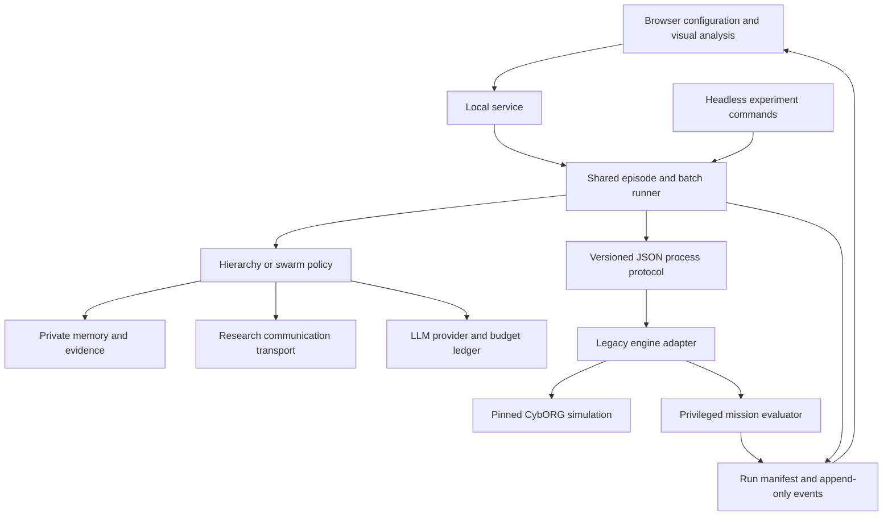

# Research workbench system design

**Authoritative scope update, 5 October 2026:**
[REVISED_GRADUATION_PLAN.md](REVISED_GRADUATION_PLAN.md), sections 4–11 and 16,
specifies the bounded remaining architecture, native extension boundary, contracts
and UI. The larger target layout and original legacy audit below are historical
design material. CC4 is already selectable; wording below that says only legacy
is enabled is superseded by CC4_ADAPTER_ACCEPTANCE.md. Credentials, diagnostic
actions and patch are proposed required extensions, not current capabilities.
No system code was changed for this plan revision.

## 1. Product and research boundary

Build a local browser application where a researcher compares hierarchical and
swarm LLM attacker teams on complex, partially observed, changing cyber tasks.
Rule/planner, single-agent and independent-worker controls diagnose adaptation
demands and coordination benefits. Researchers configure scenarios, team size,
communication and complexity modules, inspect runs, launch planned matrices and
export evidence. A programmer can add a policy or environment module without
rewriting the UI or simulator.

Preserve the offensive mission: teams discover services, acquire sessions,
gain privileges and reach designated assets. The primary question is how
organization changes adaptation, success and cost under specified cyber
complexity. Include static controls and held-out changing tasks; qualify every
new physical effect. The first objective is privileged target access, extended
with optional dwell/dependencies. Service disruption is a separate later
profile. Do not claim human attacker equivalence without human evaluation.

The scientific claim concerns adaptive LLM reasoning and organization within a documented simulation. LLM decision-making does not automatically make the environment realistic or reproduce human attackers. The contribution must come from a validated method or new empirical insight.

The revised Phase 3 architecture is specified in
[ENVIRONMENT_COMPLEXITY_DESIGN.md](ENVIRONMENT_COMPLEXITY_DESIGN.md). It adds a
versioned profile compiler, native topology/service/reachability modules,
timestamped observations, bounded active defense, physical mission evaluation,
explicit event phases and capability-derived UI settings. This is proposed
design; the accepted implementation still enables the legacy profile only.

## 2. CybORG audit and integration decisions

All source paths below refer to the currently installed `CybORG/` checkout at commit `2742b5e0ce4330c9b14006b38acd3b5ebe00d6fd`.

| Source | Verified behavior | Implementation consequence |
| --- | --- | --- |
| `CybORG/env.py` | Constructor requires a `ScenarioGenerator`; `parallel_step` accepts a dictionary of actions and returns observation/reward/done dictionaries. | Integrate through an adapter, using a fresh joint-action dictionary per tick. Do not use stale tutorial snippets that pass a file path directly. |
| `Shared/Scenarios/ScenarioGenerator.py` | `create_scenario`, validation, and termination are extension points. | Implement an enterprise research generator outside the vendor package. |
| `Shared/Scenario.py` | Defines agents, teams, host descriptions, subnets, initial sessions, and calculator mappings. | Agent count and initial access are scenario parameters, not just an LLM loop setting. Build team mappings explicitly. |
| `Simulator/State.py` | Hosts, graph links, users, processes, and sessions constitute actual state. Sessions are indexed by agent and ID. | Keep native session ownership. Use this state only inside the engine/privileged recorder. |
| `Shared/EnvironmentController.py` | Missing actions are supplied by internal agents; observations are replaced each tick; action validity is checked against action-space entries. | Assign `SleepAgent` to externally controlled workers and send explicit actions, including Sleep. Maintain agent memory outside transient observations. |
| `Shared/ActionSpace.py`, `Shared/AgentInterface.py` | Action-space maps include hidden values with `False` flags, because initialization adds true-state entries as unknown. | Never serialize all map keys into an LLM prompt. Filter to permitted values, further limited to evidence available to the logical agent. |
| `Simulator/Actions/ConcreteActions/Portscan.py` | Two lookups use `state.sessions['Red']` rather than `self.agent`. | Required small compatibility patch for multiple named red workers. Runtime probe confirms this specific correction. |
| `DiscoverNetworkServices.py`, `Simulator/Session.py` | Service discovery stores ports in the acting red abstract session. | Bridge verified received address evidence into native known-parameter flags, then require the recipient to rescan before exploiting. Port caches and sessions are not shared. |
| `ExploitRemoteService.py` | Selects a concrete exploit from observed ports, then creates a session if the simulated conditions permit it. | Primary study measures high-level strategic choices; it does not measure LLM exploit construction or fine-grained vulnerability selection. |
| `PrivilegeEscalate.py`, `Impact.py` | Operate on the named actor's sessions, with OS/service-specific logic. | Qualify each mission/action combination with fixtures before adding it to experiments. |
| `Shared/RedRewardCalculator.py` | Compromise reward compares session `Agent` with a single name. | Existing calculators cannot simply be relabeled to score a multi-attacker team. Implement a team calculator and independent mission evaluator. |
| `env.py`, `EnvironmentController.py` | `parallel_step` repeats a team's reward for its actors. | Read one reward per team. Never sum the same team reward N times. |
| `EnvironmentController.send_messages` | Messages are 16-bit binary vectors broadcast to connected agents. The payload has no native sender field. | Build a research message transport with sender, recipient, provenance, delay, and loss outside native messaging. |
| `SimulationController.py` | Joint actions execute sequentially by priority; sending order is shuffled for bandwidth accounting. | Simultaneous decisions do not imply simultaneous state changes. Record executed ordering and RNG provenance. |
| `SimulationController.py`, abstract action classes | Bandwidth/drop preprocessing applies to top-level `RemoteAction` instances; several abstract actions wrap remote sub-actions while inheriting plain `Action`. | Do not advertise abstract-action network saturation as a validated research factor. Keep communication stress in the explicitly modeled transport; qualify any later cyber-bandwidth extension separately. |
| `Action.py`, `FileReaderScenarioGenerator.py` | Routing uses graph links; enterprise firewall access includes hostname/subnet-specific logic. Modern action paths do not establish full port-level NACL enforcement. | Preserve and document the legacy enterprise policy in its baseline. Add an explicit, tested reachability policy for generic four-zone scenarios. Do not claim a real firewall model. |
| `SimulationController.py` | `pause`, `save`, and `restore` are no-ops. | Implement pause at the research loop boundary and replay from stored events. Do not advertise arbitrary checkpoint resume. |
| `env.py` | Renderer initialization/import is commented out; only simulation is constructed despite older references to AWS. | Build a new UI. No cloud simulator is required or provided by this installed path. |
| `Tutorial/z. Developer's Guide.md` | Contains older paths and API examples; recommends a tested Python 3.8.11 environment. | Treat source and executable probes as authority when tutorial examples disagree. |

### Required vendor correction

In `Simulator/Actions/ConcreteActions/Portscan.py`, replace exactly the two session-index expressions `state.sessions['Red'][self.session]` with `state.sessions[self.agent][self.session]`. Commit this correction in a small fork or maintain a reviewed patch applied to the pinned upstream revision. Add multi-actor regression tests. Do not ship the audit's temporary monkey patch as the production solution.

Further engine changes require a named regression case and a documented patch. Avoid global Gym replacement, bulk Python modernization, or replacing CybORG's cyber model during this study.

### Current checkout versus CAGE Challenge 4

The [CC4 repository](https://github.com/cage-challenge/cage-challenge-4) provides an enterprise MARL benchmark with five native defenders, varying hosts/services, action durations, and changing mission phases. It is a separate CybORG distribution. Its native mechanisms are useful for the offensive research environment; its stock scenario does not provide an arbitrary-size offensive-team experiment unchanged.

Updated decision, 4 October 2026: the [CC4 compatibility audit](CC4_COMPATIBILITY_AUDIT.md)
supports targeting CC4 for the complex research backend before extensively
extending the legacy engine. A custom generator demonstrated 1/2/4/8 mobile
workers and private session/scan ownership without patching the controller.
Retain the accepted legacy backend and introduce an isolated CC4 adapter;
that [adapter is implemented and selectable](CC4_ADAPTER_ACCEPTANCE.md), while
complete research qualification remains pending. The original
legacy design below remains the description of the implemented backend.
Do not put both incompatible `CybORG` distributions into one Python environment.
Do not compare their raw reward numbers as if they were equivalent tasks.

## 3. Entities and configurable team size

Keep these concepts separate:

- **Host:** a simulated machine; may contain multiple services, users, and sessions.
- **Native actor:** a CybORG agent with allowed actions and its own simulator sessions.
- **Worker:** an LLM reasoning agent mapped one-to-one to an externally controlled native red actor.
- **Coordinator:** an additional cognitive agent in hierarchical mode. It has no native session and performs no cyber tool action.
- **Session:** simulated access belonging to one native actor on one host. Knowing another worker's session ID does not grant access.
- **Team:** workers sharing a mission and score while retaining separate knowledge and access.

The UI's **worker count** controls native red actors and LLM workers together. Start with 1-8 workers; expand the supported limit only after scenario and performance qualification. Hierarchy with four workers means four attackers plus one coordinator; swarm with four workers means four attackers and no coordinator. Show these counts separately and charge all coordinator calls to the team budget.

The main hierarchy/swarm comparison matches worker count, initial privileges, session placement, action opportunities, models, and total token allowance. An additional matched-total-reasoner analysis can compare four workers plus a coordinator against five peer workers; label it separately because executor counts then differ.

Agent count, network size, initial access, and architecture are independent settings. Adding agents must not silently add network hosts. For a fixed worker count, both modes receive the same materialized world and footholds. A team-size sweep intentionally changes resources and must report that fact.

Primary foothold profile: each worker starts with its own abstract controlling session on the same specified entry host. This grants the same starting machine access across modes, not N different compromised assets. Secondary profile: distributed footholds on matched entry hosts. The duplicated starting sessions can affect detection/recovery; test and disclose this modeling choice.

Workers report discoveries, not credentials or session ownership transfers. An optional later transfer action must explicitly define ownership, cost, authorization, and effects; it is not implicit in a chat message.

## 4. Repository structure

Target layout; creating this plan has not moved or deleted the existing checkout:

```text
AbstractCyberSim/
  README.md
  docs/research/                  # specification and research protocol
  CybORG/                        # existing pinned checkout; future fork/submodule
  patches/                       # reviewed compatibility diffs and rationale
  locks/
    engine-environment.yml       # exact conda export for legacy worker
    engine-requirements.txt
    service-requirements.lock
  packages/
    contracts/                   # JSON Schemas and generated TS/Python types
    engine_worker/               # Python 3.8; sole importer of CybORG
      protocol.py
      adapter.py
      action_catalog.py
      scenario_generator.py
      host_templates.py
      reachability_policy.py
      mission_evaluator.py
      team_rewards.py
      truth_snapshot.py
  backend/                       # modern Python, FastAPI, SQLite
    app/api/                     # HTTP endpoints and event stream
    app/core/                    # policies, memory, message bus, budgets
    app/providers/               # real LLM, local model, mock, replay
    app/runs/                    # episode loop, queue, manifests, recovery
    app/evaluation/              # metrics and analysis jobs
  frontend/                      # React + TypeScript
    src/pages/                   # setup, live run, replay, batch, results
    src/components/              # graphs, inspector, timelines, settings
  scenarios/                     # versioned declarative scenario profiles
  configs/                       # episode profiles and experiment plans
  prompts/                       # versioned worker and coordinator templates
  tests/
    engine/ contracts/ policies/ integration/ evaluation/ ui/
  tools/                         # doctor, audit, launch, export utilities
  artifacts/                     # ignored generated run/batch directories
```

Do not maintain independent copies of the simulator in the original Mesa project and the research workbench. Preserve the Mesa prototype as a baseline/archive if useful; it is not the engine for the new primary comparison.

No core package imports FastAPI or frontend code. No policy imports CybORG. All CybORG imports and privileged state access stay in `engine_worker`. Each module gets an explicit protocol; changing UI controls must not change policy execution.

## 5. Runtime architecture

Use two Python environments so the legacy simulator does not constrain the web service, provider SDKs, or analytics.

- Engine process: existing Python 3.8.11 / NumPy 1.21.6 / Gym 0.23.1, with all other actual dependency versions exported and pinned before implementation experiments. Python 3.8 is an isolated compatibility runtime, not a recommendation for new service code.
- Service: Python 3.12 initially, modern FastAPI/Pydantic-compatible packages selected and locked during implementation.
- UI: React/TypeScript, Vite, Cytoscape.js for networks and team graphs. Use a chart library for exploratory dashboards; export scientific figures with Matplotlib in analysis jobs.
- Storage: SQLite for job metadata; append-only JSONL and snapshots for run records. A local process queue is sufficient initially.
- Connectivity: HTTP commands and a WebSocket event stream between UI and service; length-bounded JSONL over stdin/stdout between service and its local engine child. Reserve stdout for protocol; logs and library warnings go to stderr. No pickle or dynamic code in the protocol.

One child simulator per active episode. The service owns all LLM calls and asynchronous coordination. Batch concurrency starts at one and is configurable within resource/provider limits. Opening or closing the browser must not start, stop, or accelerate the scientific loop.



Local simulation needs no AWS/cloud deployment. A hosted LLM requires internet and API access; an optional local provider requires suitable local model hardware. The visualization and mock/replay provider must work without API credentials.

## 6. Layer contracts

| Layer | Required interface | Boundary |
| --- | --- | --- |
| Scenario registry | `list_profiles`, `validate_config`, `materialize(world_seed) -> WorldSpec` | Declares supported knobs, feasible limits, templates, objective, and graph policy. |
| Engine adapter | `create(WorldSpec)`, `observe(actor)`, `ingest_intel(actor, delivered_evidence)`, `allowed_actions(actor)`, `step(JointAction) -> StepResult`, `close()` | Sole owner of simulator lifecycle and native objects. |
| Truth recorder | `snapshot() -> WorldSnapshot`, `evaluate(objective) -> MissionStatus` | Researcher/evaluator data only; not passed to policy. |
| Observation codec | `encode(raw_obs) -> ObservationDelta` | Converts enums, IPs, arrays, and sessions to plain versioned JSON. |
| Agent memory | `ingest(delta, provenance)`, `view(max_context)`, `reset()` | Stores private evidence, received claims, pending tasks, and outcomes. |
| Policy | `initialize(context)`; worker `decide(own_view, own_inbox, budget)`; coordinator `assign(delivered_reports, budget)` | Swarm workers never receive a collection of other workers' private views. Neither policy sees actual world state, hidden action keys, or the engine object. |
| Message transport | `send(envelopes, tick)`, `deliver(tick)`, `connection_events(tick)` | Enforces research topology, latency, loss, size, and same-team recipients. |
| Provider | `decide(request) -> response, usage`, `cancel(request_id)` | Mock, hosted, local, or recorded responses through one interface. |
| Budget ledger | `reserve(request)`, `settle(actual_usage)`, `remaining()` | Counts leader, worker, summaries, retries, repair, and message-reasoning calls. |
| Evaluation | `reduce(events, truth, manifest) -> metrics`, `compare(batch)` | Offline calculation from authoritative logs, independent of UI state. |
| Run storage | `append(event)`, `snapshot(tick)`, `manifest()`, `replay(cursor)` | One canonical run record for live view, replay, and export. |

UI JSON and CLI JSON are validated against identical contracts. Reject unknown config fields and unsupported scenario-policy combinations. Plugins are registered by stable IDs in code; configs cannot supply arbitrary Python imports or source code.

## 7. Decision and information semantics

### Agent views

Maintain three distinct graphs: physical network links, communication links between reasoning agents, and an agent's discovered/believed world. An agent view contains its actual observations, memory, delivered messages, mission brief, and eligible actions. The leader receives only reports delivered through the message transport. It is not omniscient.

Filter native action-space values whose flags are `False`. Also remove any values unsupported by that actor's evidence. Preserve unknown truth as unknown; do not label unobserved hosts as safe. Researcher truth can be displayed in the UI but never included in provider requests.

Use `TRUE`, `FALSE`, and `UNKNOWN` action outcomes explicitly. Python truthiness of an enum is not a success test. Requested, scheduler-selected, native-executed, rejected, and completed outcomes are separate events. A target selected by a worker is not automatically compromised.

### Structured decisions

Worker response contract:

```json
{
  "action": "DiscoverNetworkServices",
  "parameters": {"ip_address": "10.0.1.12", "session": 0},
  "task_id": "task-17",
  "evidence_ids": ["obs-19"],
  "rationale_summary": "Check the reported service before attempting access.",
  "messages": []
}
```

Bind `agent` from the authenticated worker mapping, never from model output. Map allowlisted action names to constructors; parse IP/subnet types; validate parameters and known values. No shell command or Python code is executed by an LLM response. Log a concise declared rationale and evidence; do not require or claim access to a model's private reasoning.

Permit at most one schema-repair call per decision, charged to the budget. If repair fails, record `invalid_decision` and execute Sleep for that actor. Native validity checks remain enabled. Native/engine errors become `engine_error`; do not silently turn them into successful or ordinary failed missions.

### High-level action catalog

Initial offensive catalog: Sleep, DiscoverRemoteSystems, DiscoverNetworkServices, ExploitRemoteService, PrivilegeEscalate. Add Impact only in a separately qualified service-disruption scenario. Lateral movement is represented by acquiring sessions on additional hosts; there is no invented generic `Move` action.

Attach a researcher help card to every action: prerequisites, observations returned, actual state effects, simulation assumptions, and links to implementation. Abstract exploit selection is CybORG's built-in selector. A later explicit-exploit profile may expose individual supported exploit classes, but must have its own catalog, validation, tests, and experimental version.

Use only compatible controlling session types for abstract scans and cached port information. A new reverse-shell session is not automatically a new abstract controller; session ID existence alone does not establish eligibility. Do not advertise arbitrary pivot-session scanning until it passes qualification.

## 8. Coordination policies

### Hierarchy v1

N workers own N native actors. An extra coordinator owns the task ledger and receives worker reports through a star topology. At each planning opportunity it emits task assignments: worker, task ID, known target, allowed action family, completion condition, expiry, and priority. Workers choose concrete parameters/actions inside their delegated task; they do not silently create new missions outside it.

Coordinator prompts include the mission, its accumulated reports, outstanding assignments, and known capabilities. Worker prompts include private observations, delivered assignments, and previous outcomes. Bootstrap assignments and reports use the same transport delays as later messages. A worker with no valid assignment waits or performs an explicitly configured bootstrap task. Report re-planning frequency as a parameter.

Lost leader connectivity produces queued/expired assignments, measurable idle time, and stale plans. Do not automatically grant peer coordination on failure; that would implement a hybrid policy instead.

### Swarm v1

N workers make decisions using private observations and delivered peer messages. Use a declared peer topology. A worker can announce a task claim with target/action family, priority, and expiry. Claims received before the next decision use a deterministic tie-break derived from claim key, experiment seed, and worker ID. Workers honor known competing claims; unseen or delayed claims may still cause duplicate work, which is an experimental outcome.

There is no central task allocator, global memory, or hidden global deduplication. The platform may schedule action opportunities and enforce budgets equally across all modes; this resource mechanism does not decide cyber goals. Fixed sorting or tie-breaking must not act as a privileged leader.

Expose peer degree, message cap, claim expiry, and sharing policy. Sharing choices initially are discoveries, compact status reports, or no communication. Shared data stays labeled as peer-reported until corroborated by the recipient's own observations.

### Optional adaptive policy

Implement only after hierarchy and swarm are correct. It changes coordination topology using observable signals such as recent duplicate attempts, stalled tasks, delivery failures, or disagreement. It cannot switch based on privileged true compromise counts. Freeze thresholds using development scenarios, then evaluate on held-out ones. Compare against a fixed hybrid and random switching to identify the source of any gain.

This is adaptive orchestration, not genetic/evolutionary optimization. If evolution is later desired, define genomes, training worlds, fitness budgets, and untouched evaluation worlds as a separate extension.

## 9. Communication model

Research message envelope:

```json
{
  "id": "msg-42", "sender": "worker-0", "recipients": ["coordinator"],
  "kind": "discovery", "created_tick": 12, "deliver_tick": 14,
  "ttl_ticks": 5, "evidence_ids": ["obs-19"],
  "payload": {"ip_address": "10.0.1.12", "ports": [80]}
}
```

The transport supports star, mesh, and seeded sparse peer graphs, plus scheduled link interruption. For an envelope created at tick t with configured extra delay d, delivery is at the start of tick `t + 1 + d`. There are no same-tick recursive conversations. Each recipient copy consumes delivery capacity; broadcast is not free.

Set per-team per-tick message byte and envelope limits. Use deterministic queue ordering by creation tick and message ID, seeded loss per envelope-recipient pair, and explicit events for delivery, loss, expiry, and overflow. Payload-size units are UTF-8 bytes; LLM token usage is a separate metric. Natural-language generation cost is billed by the provider; transport does not automatically create extra model calls.

The default transport is a virtual coordination channel, independent of cyber packet routing. Its loss/delay parameters are experimental abstractions, not measured network packet behavior. A later route-coupled transport may enforce actual simulator reachability inside the privileged adapter, but must not reveal hidden hosts/routes to policies.

Native `send_messages` is unused for research coordination initially. Implement an explicit `ingest_intel` adapter operation at message delivery: verify that the sender possesses the referenced delivered/observed evidence, then construct an allowlisted observation fragment containing observed IPs/subnets/hostnames and update the recipient's native known-parameter flags through `AgentInterface.update`. This is a declared research information-sharing rule, not stock automatic CybORG behavior. Charge transport capacity/delay normally and record the resulting knowledge change.

Only actually delivered, provenance-checked address evidence can mark a parameter known. Guessed or hallucinated fields remain claims and cannot unlock native actions. Do not grant fields outside the scenario's sharing/access policy. Never merge sessions, users/credentials, privilege status, or port caches through this operation. Ports can be reported in private memory, but the recipient must perform its own service scan to populate its native abstract session's cache before exploitation. Do not bypass native action validity checks.

Without this bridge, a reported new IP may still have a native `False` flag and even a rescan is rejected. Qualify that negative case and the bridge's positive case. Treat this information rule as part of the research model and test a no-sharing ablation. Optional future cache/credential transfer needs separately defined costs and semantics.

## 10. Exact episode loop

1. Resolve and validate configuration; produce an immutable materialized world, registry/version hashes, worker mapping, and RNG seeds. Preflight simulator and provider capabilities. Create a new engine process for this episode.
2. Initialize the engine with that fixed world. A reset must return the same materialized world; do not generate a new topology implicitly. Collect initial actor observations and privileged snapshot into separate channels.
3. At tick t, deliver due messages and scheduled disruptions. Update each recipient's private memory from its own prior observation and delivered envelopes. Apply the verified-address intel bridge for entitled recipients before computing action candidates.
4. Execute the mode's bounded reasoning round, with explicit coordinator/worker call dependencies. Reserve budget before concurrent calls. Store provider requests, responses, usage, and invalid/timeout events.
5. Validate proposals. Select allowed cyber action opportunities with the same neutral scheduler in each architecture. Submit exactly one fresh joint-action map to `parallel_step`; actors without an opportunity or valid decision receive Sleep. Do not step once per worker, which would advance opponents multiple times.
6. Normalize native observations and actual actions, record ordering/invalid replacements, then collect the privileged snapshot and objective state. Enqueue outgoing messages for future ticks. Do not feed privileged results into the next prompt.
7. Stop for achieved objective, horizon, budget exhaustion, manual stop, provider failure, or engine failure. Each reason has a distinct outcome classification. Otherwise move to tick t+1.
8. Write final summary and manifest atomically. Run the same reducers used by batch analysis. Close child processes and release pending budget reservations.

Service wall-clock latency and simulator ticks are different clocks. Pause waits at a tick boundary, allowing in-flight calls to complete and their cost to be logged. Replay playback speed changes only display timing. Closing a browser leaves an active run intact.

Equal-priority native actions may preserve input order rather than use the shuffled bandwidth order. Construct red-worker joint-action insertion order using a seeded neutral permutation each tick, identically distributed across modes, preserve native priority rules, and record the actual order. Do not let provider response speed, UI selection order, or a coordinator's list order silently grant first-execution priority.

For action scheduling, support `per_worker` (one cyber action per worker per tick) and `team_cap` (a fixed total team limit). Use seeded round-robin eligibility independent of policy and hidden state; only eligible workers request a cyber-action decision to avoid pointless calls. A leader can still plan within the shared budget. Architecture comparisons match the scheduler; team-size conclusions include a `team_cap=1` sensitivity condition to distinguish cognition from extra parallel tool capacity.

## 11. UI screens and controls

### Setup

Choose scenario profile, objective, architecture, worker count, model preset, observation/sharing profile, defender preset, communication delay/loss/cap, simulation horizon, token/cost budget, seed, and run mode. Advanced settings expand without obscuring defaults. Show worker/coordinator counts, estimated calls, validations, and enabled action cards.

Save/load/duplicate configuration and export JSON. Before starting, show the exact resolved experiment settings. Changing team size or mode during a run creates a new configured episode. It does not silently modify the scored experiment. Exploration can inject a manual task/action or scripted disruption; mark the run as manually intervened.

### Live laboratory

Layout: controls on the left; physical network in the center; team communication graph beside or below it; agent/host inspector on the right; action/message timeline along the bottom.

Physical graph groups hosts by security zone. Color reflects observed or privileged compromise/privilege status, not merely an LLM claim. Distinguish neutral, unknown, low-privilege foothold, privileged compromise, removed access, and impacted service. A host may have several attacker and defender sessions; show badges instead of asserting exclusive ownership. Edges represent structural connectivity; policy-blocked reachability is a separate visual attribute.

View selector: researcher truth, selected worker knowledge, or coordinator knowledge. Switching this selector is read-only and must never affect prompts. Unknown hosts disappear or appear as explicit unknown placeholders in agent view; unobserved vulnerability details are hidden. Label peer reports and stale observations.

Team graph shows leader/worker/peer roles, actual message links, queued/dropped messages, assignments/claims, selected actions, and per-agent token/call usage. Animate communication separately from scans/exploits. On a selected action, show requested action, validation result, execution result, evidence links, declared rationale, and state changes.

Run controls: start, pause at boundary, single tick, continue, stop. A live-run timeline cannot seek backward and resume from arbitrary history. Use replay for backward navigation. Add a Compare button that launches both architectures from one materialized scenario rather than switching the running policy.

### Replay and comparison

Load stored runs without API calls. Timeline slider, play speed, and previous/next action display saved snapshots and events. Side-by-side comparisons align by simulator tick or consumed tokens; show terminated runs as terminated, without inventing later frames. Reproducing provider transcripts is distinct from requesting a fresh stochastic rerun.

### Experiment builder

Select scenario families, modes, counts, models, seeds, repeats, and communication conditions from validated grids. Show the Cartesian count of episodes, a pilot-based token/cost estimate, and stop limits. Submit to queue, inspect progress, cancel unscheduled work, and retry technical failures as separate attempts.

### Results

Success rate with confidence intervals; steps to objective with failure/censoring context; success-versus-tokens frontier; duplicate work; invalid decisions; delivered/lost/expired messages; leader/worker budget shares; and failure categories. Compare matched cells and export CSV, run bundles, analysis specification, and SVG/PDF scientific plots. Every chart shows sample count, filters, exclusions, and metric version.

## 12. What is configuration and what remains code

| Researcher operation | UI | Saved configuration | Programmer needed? |
| --- | --- | --- | --- |
| Select hierarchy/swarm or change worker count | Yes | Policy and team fields | No, within qualified limits |
| Change existing graph/scenario parameters | Yes | Scenario profile fields | No |
| Choose model, temperature, limits, seed | Yes | Provider/budget fields | No |
| Choose sharing, communication loss/delay/topology | Yes | Transport fields | No |
| Configure experiment sweep and analysis groups | Yes | Experiment plan | No |
| Choose an existing prompt preset | Yes | Prompt ID and hash | No |
| Create/edit prompt text | Advanced editor | New versioned prompt artifact | No code; validation/pilot required |
| Define a new orchestration algorithm | Select after registration | Registered policy ID/parameters | Yes |
| Add an exploit, permission model, action precondition, or new metric | Select after registration | Registered version | Yes, with tests |
| Build a fundamentally different scenario family | Parameter editor after implementation | Scenario registry ID | Yes |
| Choose analysis method from supported presets | Yes | Analysis plan | No |
| Add a new statistical estimator | Select after registration | Estimator ID/version | Yes |

A form and a JSON config invoke the same behavior. A scientist should not edit a Python experiment script to vary normal settings. Arbitrary scenario semantics cannot safely be defined by a slider alone.

## 13. Data model and API

Configuration schemas: EpisodeConfig, WorldSpec, ExperimentPlan, AnalysisPlan. Runtime schemas: AgentView, ActionProposal, JointAction, ObservationDelta, MessageEnvelope, WorldSnapshot, DecisionBatch, RunEvent, EpisodeSummary. All carry `schema_version`; stable IDs and simulation tick identify entities.

Run event envelope: `run_id`, monotonic `sequence`, `tick`, event type, actor/message/task ID if relevant, payload, timestamp, and visibility (`agent`, `team`, or `researcher`). A filtered stream is not the authoritative record. Observation evidence IDs must be resolvable to logged source events.

Store worker views, coordinator views, truth snapshots, and messages in separate logical channels. Initial implementation writes all snapshots per tick for debugging. Later compression/keyframes can reduce storage without changing semantics.

HTTP endpoints to implement:

- `GET /capabilities`, `/scenarios`, `/policies`, `/models`: registered versions and parameter schemas.
- `POST /configs/validate`: validation errors plus resolved config and world preview.
- `POST /runs`: create an episode; accept idempotency key.
- `GET /runs/{id}` and `/runs/{id}/events?after_sequence=`: state and reconnectable history.
- `POST /runs/{id}/commands`: pause, single_tick, continue, stop; manual action only in exploration mode.
- `GET /runs/{id}/snapshots/{tick}?view=truth|worker:ID|coordinator`: replay view.
- `WS /runs/{id}/stream`: ordered events; reconnect using last sequence.
- `POST /batches`, `GET /batches/{id}`, `POST /batches/{id}/cancel`: headless job queue.
- `POST /analyses`, `GET /analyses/{id}`, `GET /exports/{id}`: persisted analysis and file exports.

Engine protocol operations: hello/capabilities, create, observe, ingest_intel, step, snapshot, close. Each request includes request ID and protocol version; each response includes the same ID and a success/error discriminator. A timeout has a bounded shutdown path. Privileged snapshot operations are not exposed to policies; policies cannot invoke ingest_intel directly or fabricate its evidence authorization.

Run artifacts:

```text
artifacts/runs/<run_id>/
  manifest.json                 # code/engine commits, locks, model/prompt IDs
  config.resolved.json
  world.materialized.json       # initial graph/services/access, before decisions
  events.jsonl
  decisions.jsonl               # prompts, declared rationales, usage, responses
  messages.jsonl
  observations.jsonl
  truth.snapshots.jsonl
  summary.json
artifacts/batches/<batch_id>/
  plan.resolved.json
  jobs.jsonl
  episode_metrics.csv
  analysis.json
  figures/
```

Model endpoint, exact returned model ID/revision where available, generation parameters, prompt/template hashes, system fingerprint when provided, provider request IDs, and SDK versions belong in manifests. A seed alone cannot guarantee hosted-model reproducibility.

## 14. Modularity rules and non-goals

To add a policy: implement the policy interface, declare parameters, register it, pass information/budget tests, then the UI discovers it. To add a scenario: implement/extend a generator profile, declare supported actions and limits, qualify solutions/failures, then expose its parameters. To add a metric: implement a versioned event reducer and fixtures; historical runs can be reanalyzed.

Do not duplicate scheduling logic in UI callbacks. Do not let the browser choose action results. Do not mix old drone/blue metrics into offensive mission scoring. Do not use global truth for centralized policy advantages. Do not let architecture selection change vulnerability distribution. Do not infer general robustness from the three-action runtime probe.

Live arbitrary topology editing, automatic exploit invention, production-network control, cloud emulation, RL training infrastructure, and unrestricted checkpoint branching are outside the first implementation. A validated local workbench and a defensible experiment suite are the completion criteria.

Framework references: [FastAPI event transport](https://fastapi.tiangolo.com/advanced/websockets/), [React UI components](https://react.dev/learn), [Cytoscape.js graph interface](https://js.cytoscape.org/). Exact dependency versions are an implementation lock decision after compatibility checks, not an unverified latest-version promise.
